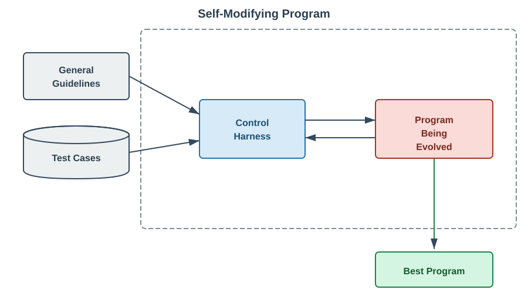

# Building accurate and trustworthy GenAI applications, based on description logic ontologies

One roadblock to the broad adoption of agentic systems (for example, chatbots or
research agents) is their tendency to hallucinate and to reason incorrectly.
This is particularly acute in regulated domains like healthcare or finance where
inaccurate responses are costly. We show here how to build agentic systems whose
responses are _provably correct_.

This work shows how to build hybrid systems that combine a large language model
(LLM) with a description logic reasoner. It starts by downloading an ontology
that is available in OWL 2 DL format (a `.owl` file). It then builds a
description logic reasoner to answer questions about that ontology. It does
this by, first, creating a program that can interrogate the chosen ontology,
and, second, using that program to answer questions about the subject matter
of the ontology.

To be concrete, this work shows how to build an agentic system that can
provide *provably correct* answers to questions like this:

**Question:** What are the parts of the heart?

**Answer:** The human heart is a four-chambered muscular organ comprising the
          right/left atria (upper chambers) and right/left ventricles (lower
          chambers). It includes four valves (tricuspid, pulmonary, mitral, 
          aortic) to control flow, the septum dividing the sides, and major
          vessels like the vena cava and aorta to pump blood.

**Question:** Does TP53 interact with DNA?

**Answer:** Yes, it has DNA-binding transcription factor activity.

**Question:** What are all the specific sub-types and variations of Pneumonia?

**Answer:** Pneumonia is classified by its cause, where it was acquired, and which
          part of the lung it affects. The main types are bacterial, viral,
          fungal, and aspiration pneumonia.

The framework described herein builds agentic systems that answers questions
like these _accurately_. It does so by switching out the LLM reasoner (which 
makes mistakes) with an ontological reasoner (which is provably correct).

## Background 
According to Accenture[^1], companies with AI-led processes achieve 2.5x higher
revenue growth, 2.4x greater productivity, and 3.3x greater success at scaling
generative AI use cases. Also, McKinsey research[^2] indicates that generative
AI has the potential to automate work activities that absorb 60 to 70 percent
of employees' time today. ChatGPT Enterprise users report 40-60 minutes of saved
time per day thanks to AI use[^3]. Data science, engineering and communications
workers save more than average at 60-80 minutes per day. 

## The problem 
In domains like healthcare, accuracy is critical. For example, if a clinical
application says that “Patient X’s most recent blood pressure was 300/80” and
this is not true, then providers and patients will rightly not trust it and,
equally rightly, will not use it. Worse, patients could be harmed. 

Unfortunately, state-of-the-art large language models (LLMs) and large
multimodal models (LMMs), while showing a masterful display of the syntax
of natural (and formal) languages, still hallucinate and reason incorrectly. Despite
the industry’s reliance on the now-discredited scaling laws[^4], and even
though today’s models are more powerful and capable than models of even 6
months ago, the latest models still consistently hallucinate (and, on some
metrics, they hallucinate worse[^5] than older models).

For us to trust Generative AI chatbots, we must trust that these applications
are accurate. The industry’s current reliance on scaling laws (i.e., using the
same technology but using more parameters, training for longer, and on more data)
has not yet provided us a reliable path towards trustworthy systems with fewer
hallucinations and reasoning errors. 

We can see this problem across industries. An MIT study[^6], for example, found
that “95% of generative AI pilots fail”. According to Cap Gemini[^7], “trust in
fully autonomous AI agents has dropped sharply, from 43% to 27% in [the year
ending mid-2025]”. 

These concerns are heightened in regulated industries such as healthcare, 
life sciences, or finance because the cost of an error is higher than in
many other domains.

## Introduction

This project describes a framework for building neurosymbolic AI
systems that can accurately answer questions based on (biomedical) ontologies.
Rather than relying solely on an LLM to generate answers (which risks
hallucinations), the system uses a hybrid approach:

1. an LLM inference decomposes a natural language question into an internal
representation;

2. a symbolic reasoner (created here) traverses the ontology graph to produce a
grounded, verifiable answer (in another internal representation); and 

3. an LLM inference converts this internal answer back into natural language.

We here demonstrate this system with working code and with ten different
real-world ontologies. Each is configured in
[`ontology_config.yaml`](ontology_config.yaml), served by the web app, and
exposed as an `answer_question_with_<NAME>` tool by the MCP server:

| Name | Ontology | Description |
|---|---|---|
| `FMA` | [Foundational Model of Anatomy](https://bioportal.bioontology.org/ontologies/FMA) | A comprehensive ontology of human anatomy |
| `GO` | [Gene Ontology](https://geneontology.org) | The world's largest source of information on the functions of genes (served from the extended `go-plus` release) |
| `CTO` | [Clinical Trial Ontology](https://github.com/ClinicalTrialOntology/CTO) | Concepts describing clinical trials: design, phases, interventions, outcomes and participants |
| `CL` | [Cell Ontology](http://obofoundry.org/ontology/cl.html) | Classifies and describes cell types across organisms, with over 2,700 cell type classes |
| `HPO` | [Human Phenotype Ontology](https://hpo.jax.org) | A standardized vocabulary of phenotypic abnormalities encountered in human disease |
| `NCIt` | [NCI Thesaurus](https://ncithesaurus.nci.nih.gov) | The National Cancer Institute's reference terminology for cancer, clinical care and translational research |
| `OBI` | [Ontology for Biomedical Investigations](http://obi-ontology.org) | Describes the protocols, instruments, materials, data and analyses of biomedical investigations |
| `OGMS` | [Ontology for General Medical Science](https://github.com/OGMS/ogms) | A formal framework for the clinical domain: disease, disorder, diagnosis, signs and symptoms |
| `BFO` | [Basic Formal Ontology](https://basic-formal-ontology.org) | The top-level ontology underpinning the OBO Foundry ontologies above |
| `Mondo` | [Mondo Disease Ontology](https://mondo.monarchinitiative.org) | A unified disease ontology that harmonizes OMIM, Orphanet, NCIt, DOID and other disease resources |

The toolchain has also been exercised against
[SNOMED CT](https://www.snomed.org) (see the statistics below), which is not
part of the served catalog.

This framework has two main components:

1. An offline component (the **[builder](ontology_qa_cli/builder.py))** whose input
is an ontology file and a set of question-answer pairs. The builder's output
is a Python program that converts a natural language question into a natural
language answer (via a traversal of the ontology).

2. An online question-answering component (the **[questioner](ontology_qa_cli/query.py)**)
that uses the Python program created by the builder to answer a question.

The builder uses a self-modifying program guided by a collection of gold-standard
question-answer pairs: 



We start with a deliberately degenerate
[seed program](ontology_qa_cli/seed_program.py)
(that always says "I don't know") and then the system iteratively fixes and improves
itself — evaluating its answers against the gold standard, identifying 
failures, and rewriting its own code to improve its performance against the
gold standard test cases.

The builder has the following major components:

1. The **general guidelines** is a markdown file that lists instructions for the
system. For example, we can instruct it to only use the LLM to parse the
question and to convert the answer back into natural language, and to **not**
use the LLM to answer the question.

2. The **test cases** is a set of manually curated gold-standard 
[question-answer pairs](ontology_config.yaml).

3. The **control harness** controls the evolution of the
[seed program](ontology_qa_cli/seed_program.py) into a more effective
program. It follows the following steps:

   3.1. It executes the current program against the test set.

   3.2. It uses the LLM-as-a-judge pattern to evaluate the correctness of each
   generated answer compared to each expected answer.

   3.3. It generates a file TASK.md that includes the general guidlines along
   with the LLM-as-a-judge critiques for each answer.

   3.4. It uses [kiro-cli](https://kiro.dev/cli/) to fix the current program,
   using TASK.md, and creates a new (hopefully better) program.

   3.5. If the new program is not good enough, go back to step 3.1.

4. The **program being evolved** is a Python program. It starts as the 
[seed program](ontology_qa_cli/seed_program.py) and then the control harness,
along with
[kiro-cli](https://kiro.dev/cli/), iteratively evolves it into a program
that performs increasingly well on the test cases.

The control harness has no knowledge of the particular ontology being trained
against: all it has is the [question-answer pairs](ontology_config.yaml) and
the general guidelines. It is the responsibility of `kiro-cli` to interrogate
the given ontology file so as to understand how to query it.

The system iteratively improves its query program through an automated feedback
loop: it evaluates answers against known Q&A pairs using LLM-as-a-judge,
then uses [kiro-cli](https://kiro.dev/cli/) to fix the code based on the
feedback. Each iteration produces a (hopefully) better program that more
accurately answers the [gold-standard questions]((ontology_config.yaml))
using the target ontology.

The [architecture diagram](docs/architecture.md) shows how the source code
maps onto this functional architecture.

## Description logics

This project builds on ontologies that are available as an OWL description logic.

[Description logics](https://en.wikipedia.org/wiki/Description_logic) are a
family of logic-based knowledge representation languages that can be used to
represent the terminological knowledge of an application domain in a
structured way.

The name _description logics_ is motivated by the fact that, on the one hand,
the important notions of the domain are described by concept descriptions,
i.e., expressions that are built from atomic concepts (unary predicates) and
atomic roles (binary predicates) using the concept and role constructors
provided by the particular logic.

The main reason for using description logics rather than general first-order
predicate logic when representing knowledge is that most DLs are actually
decidable fragments of first-order predicate logic, i.e., there are effective
procedures for doing inference.

Description logics are commonly used to represent biomedical ontologies, such
as [SNOMED CT](https://www.snomed.org) or the [Gene Ontology](https://geneontology.org)
(GO).

Unlike propositional or predicate logics, description logics do not have a
declarative query language (like [SQL](https://en.wikipedia.org/wiki/SQL),
or [SMT-LIB](https://smt-lib.org)). Rather, description logics are imperatively
queried by writing a Python program that uses an API to traverse the ontology.
This means that querying a description logic ontology in an agentic system
requires the writing and critiquing a _program_, not just a declarative query
(such as a `SQL SELECT`).

## Reasoners for description logics

A description logic _reasoner_ is the engine that draws conclusions from an
ontology: it classifies concepts into a subsumption hierarchy, checks
consistency, and decides which individuals belong to which concepts. The two
most widely used general-purpose OWL 2 DL reasoners are
[HermiT](http://www.hermit-reasoner.com) and
[Openllet](https://github.com/Galigator/openllet) (the maintained successor of
Pellet). Both are sound and complete for the full expressive power of OWL 2 DL
(the description logic _SROIQ(D)_), and both are bundled with owlready2, the
Python OWL library this project uses.

Neither one suits this project, because we need two things at the same time:

1. **Expressive power.** The ontologies served here use the full range of OWL
   constructs: existential restrictions over roles (for example, a disease's
   _disease location_ or a gene's _material basis_), class intersections, and
   cross-ontology equivalence axioms. A reasoner restricted to a lightweight
   profile such as OWL 2 EL (for example, [ELK](https://github.com/liveontologies/elk-reasoner))
   scales well, but it gives up exactly the constructs that make these
   ontologies useful for question answering.

2. **Large A-boxes.** These are not toy ontologies. As the statistics below
   show, several have millions of triples and hundreds of thousands of
   classes and individuals. A description logic knowledge base has two parts:
   the _T-box_ (terminology: the concepts and the axioms relating them) and
   the _A-box_ (assertions about individuals). Tableau reasoners like HermiT
   and Openllet were designed primarily for T-box reasoning. Reasoning over
   large A-boxes (instance checking, realization, and conjunctive queries over
   many individuals) is where they scale worst. Reasoning in _SROIQ_ is
   N2EXPTIME-complete in the worst case, and both reasoners build their
   models in memory inside a JVM. In practice, on ontologies of this size,
   that means classification and A-box queries take minutes to hours or run
   out of memory, rather than answering an interactive question in seconds.

In short, the existing reasoners force a choice: full expressivity on small
ontologies (HermiT, Openllet), or scale with a restricted language (EL
reasoners). A question-answering system over large biomedical ontologies needs
both.

We therefore developed a custom reasoner, tailored to the queries a
question-answering system actually asks, rather than general-purpose
entailment. Instead of reasoning over the whole knowledge base in memory, it
works directly on owlready2's SQLite quadstore. The ontology is parsed once
into an on-disk cache and then opened read-only, so many queries run
concurrently without re-parsing or lock contention. On top of that store, the
reasoner (`ontology_qa_cli/subsumption.py`) computes answers deterministically,
with no LLM in the reasoning path:

- **Subsumption queries** ("what are _all_ the kinds of X?") are answered by
  the transitive closure of the `is-a` (`rdfs:subClassOf`) hierarchy. The
  result is complete with respect to the asserted hierarchy, not a sample
  proposed by a language model.
- **Role-restricted queries** ("all diseases of X located in the eye")
  further filter that set to the classes carrying the matching existential
  restriction, so the queries keep the ontology's expressive role structure.
- **Concept resolution** maps a natural-language phrase to an ontology class
  by exact, then fuzzy, label match, skipping obsolete classes. Ambiguous
  phrases come back as a list of candidates rather than being guessed at.

The evolved query programs that the builder produces (described above) run
against the same pre-loaded quadstore, so every ontology is loaded once per
process and answers in interactive time.

## Ontology statistics

The ontologies used here are not toy ontologies, they are actively used in
biomedical research. The following table shows some descriptive statistics
for these ontologies:

<!-- Regenerate with: uv run python -m ontology_qa_cli.ontology_stats -->

| Ontology | File Size | Lines | Classes | Object Properties | Data Properties | Individuals | Axioms (Restrictions) |
|----------|-----------|-------|---------|-------------------|-----------------|-------------|----------------------|
| [FMA](https://bioportal.bioontology.org/ontologies/FMA) | 254 MB | 3,877,972 | 104,721 | 139 | 29 | 2 | 157,831 |
| [Gene Ontology](https://geneontology.org) (GO) | 226 MB | 3,902,991 | 84,523 | 319 | 0 | 48 | 105,495 |
| [SNOMED CT](https://www.snomed.org) | 202 MB | 2,977,123 | 796,512 | 0 | — | — | 1,069,097 |
| [Cell Ontology (CL)](http://obofoundry.org/ontology/cl.html) | 63 MB | 1,011,425 | 386,110 | — | — | — | 1,105,244 |
| [Human phenotype ontology (HPO)](https://hpo.jax.org) | 81 MB | 1,358,876 | 32,085 | 235 | 0 | 0 | 20,599 |

## Prerequisites

- Ubuntu 26.04 LTS
- [uv](https://docs.astral.sh/uv/) (manages Python 3.10+ for you — see Installation)
- AWS credentials configured for Bedrock access (Opus 4.6)
- kiro-cli (see installation below)
- Java 17 (if you want to use SNOMED)

### Installing kiro-cli on Ubuntu

```bash
curl -fsSL https://cli.kiro.dev/install | bash
```

## Installing Python (optional)

uv downloads and manages a suitable Python interpreter automatically based on
`requires-python` in `pyproject.toml`, so you normally don't need to install
Python yourself. If you prefer a system Python on Ubuntu:

```
sudo apt update
sudo apt install software-properties-common -y
sudo add-apt-repository ppa:deadsnakes/ppa
sudo apt update
sudo apt install python3.13 python3.13-venv python3.13-dev
python3 --version
```

## Installation

This project uses [uv](https://docs.astral.sh/uv/) for environment and
dependency management.

Install uv (if you don't have it):

```bash
curl -LsSf https://astral.sh/uv/install.sh | sh
```

Then create the environment and install all dependencies (including the dev
group) from the lockfile:

```bash
uv sync
```

`uv sync` creates a `.venv/`, installs the project in editable mode, and pins
everything via `uv.lock`. You don't need to activate the venv — prefix commands
with `uv run` (see Usage below) and uv uses the project environment
automatically. To activate it anyway, run `source .venv/bin/activate`.

> **Note:** uv reads the required Python version from `requires-python` in
> `pyproject.toml` and will download a matching interpreter if one isn't
> available, so the manual Python install steps above are optional when using uv.


## Usage

### Per-session setup

With uv you don't need to activate a virtualenv — run CLI commands with
`uv run`, which resolves the project environment automatically. Before running,
authenticate with `kiro-cli` (`kiro login`) and then with AWS, for example:

```
export AWS_ACCESS_KEY_ID=[...]
export AWS_SECRET_ACCESS_KEY=[...]
export AWS_SESSION_TOKEN=[...]
```

### Builder CLI

Iteratively build and improve a query program for an ontology:

```bash
kiro login # only the first time in a session
uv run ontology-qa-build FMA
```

You can also invoke the module directly:

```bash
uv run python -m ontology_qa_cli.builder FMA
```

Options:

- `--ontology-config PATH` — Path to YAML config file (default: `ontology_config.yaml`)
- `--threshold FLOAT` — Accuracy threshold to stop iterating (default: 0.8)
- `--max-iterations INT` — Maximum iterations (default: 20)
- `--max-questions INT` — Maximum number of questions per evaluation round (random sample; uses all if not specified)
- `--num-failures-to-fix INT` — Number of failed questions to include in each fix round (default: all failures)
- `--kiro-timeout INT` — Timeout in seconds for kiro-cli invocations (default: no timeout)
- `--output-dir PATH` — Base directory for run outputs (default: `runs/`)
- `--llm-costs PATH` — Path to LLM cost configuration file (default: `llm-costs.yaml`)
- `--plain` — Disable the rich console UI and emit plain text output (useful for CI/log capture)

### Query CLI

Ask a question using the best program from the most recent builder run:

```bash
uv run ontology-qa-query FMA "What are the parts of the heart?"
```

Or specify an explicit program path:

```bash
uv run ontology-qa-query runs/FMA_20260506_172902/iteration_9/query_program.py "What are the parts of the heart?"
```

The first argument is either an ontology name (looks up the best program from the latest run) or a path to a `query_program.py` file.

Options:

- `--config PATH` — Path to YAML config file (default: `ontology_config.yaml`)
- `--runs-dir PATH` — Base directory where builder runs are stored (default: `runs/`)
- `--plain` — Disable the rich console UI and print the bare answer (useful for piping)

### Ontology Stats CLI

Generate a markdown table with descriptive statistics for all ontologies in the config:

```bash
uv run python -m ontology_qa_cli.ontology_stats
```

This outputs a markdown table to stdout showing file size, line count, number of classes, properties, individuals, and axioms for each ontology. You can redirect it to a file or pipe it:

```bash
uv run python -m ontology_qa_cli.ontology_stats > ontology_stats.md
```

To use a custom config file:

```bash
uv run python -m ontology_qa_cli.ontology_stats path/to/ontology_config.yaml
```

## Web application

In addition to the CLIs, the project ships a web UI (a React SPA served by the
FastAPI backend in `ontology_qa_cli/webapp.py`). It lets you pick an ontology,
build its query program on demand, and ask questions in a chat interface.

Run it locally:

```bash
# Build the SPA once (see the auth note below for the deployed build)
cd frontend && npm install && npm run build && cd ..

# Serve the API + built SPA
uv run python -m ontology_qa_cli.webapp
```

For live frontend development, run the Vite dev server (`cd frontend && npm run
dev`) alongside the backend.

### Deployment architecture (what to know before changing the web app)

The deployed app runs on AWS Fargate, fronted by an Application Load Balancer
and CloudFront, provisioned by the CDK app under `cdk/`:

- **Multiple web tasks behind the ALB.** Any request can be routed to any task,
  and a task can be replaced at any time (deploy, health check, task loss). So
  the web layer must be *stateless across tasks* — never assume a follow-up
  request lands on the task that handled the previous one.
- **Durable conversation store** (`ontology_qa_cli/conversation_store.py`). A
  conversation's irreplaceable state (its ontology binding + message history) is
  persisted to the shared EFS runs mount, so a sibling task — or a task that
  restarted — can rehydrate it. The heavy `OntologyAnswerer` is *not* persisted;
  it is rebuilt from the ontology's program on a cache miss via
  `_load_answerer(ontology)`. Handlers that need an answerer (`/api/conversation`,
  `/api/chat`) must lazy-load it on a miss rather than assuming a prior
  `/api/select` on *this* task loaded it.
- **The SPA is served from S3/CloudFront, not the container.** The `frontend/dist`
  bundle is published by the CDK **Edge** stack; the container image (Compute
  stack) carries the backend. A frontend change therefore needs an Edge deploy,
  and a backend change needs a Compute deploy.

### Frontend build-time configuration (Cognito)

The SPA reads its Cognito auth config from **build-time** `VITE_*` env vars, so
the frontend **must be rebuilt with them set before `cdk deploy`**. A plain
`npm run build` with these unset produces a bundle with authentication
**disabled** — do not ship that to the deployed app:

```bash
cd frontend
VITE_COGNITO_DOMAIN="https://<your-cognito-domain>.auth.<region>.amazoncognito.com" \
VITE_COGNITO_CLIENT_ID="<spa-app-client-id>" \
VITE_COGNITO_REDIRECT="https://<your-cloudfront-domain>/" \
npm run build
```

Use the **SPA** app client id (not a generic user-pool client). The deployed
callback/redirect URLs are driven by the CDK `appDomain` context (see
`cdk/cdk.json`); keep them in sync with the CloudFront domain.

## Downloading the ontologies

### FMA (Foundational Model of Anatomy)

Download from BioPortal (requires free account):

```bash
# Visit https://bioportal.bioontology.org/ontologies/FMA and download the OWL file
# Or use the BioPortal REST API:
curl -L -o ~/fma.owl "https://data.bioontology.org/ontologies/FMA/download?apikey=YOUR_API_KEY&download_format=rdf"
```

### Gene Ontology (GO)

Download directly from the Gene Ontology consortium:

```bash
curl -L -o ~/go-plus.owl "http://purl.obolibrary.org/obo/go/extensions/go-plus.owl"
```

### SNOMED CT

SNOMED CT requires a license. Download from the [SNOMED International Member Licensing portal](https://mlds.ihtsdotools.org/) or the [NLM UMLS](https://www.nlm.nih.gov/research/umls/licensedcontent/snomedctarchive.html) (US edition, requires free UMLS account).

Once you have the RF2 release zip, convert it to OWL using the SNOMED OWL Toolkit:

```bash
# Download the toolkit
wget https://github.com/IHTSDO/snomed-owl-toolkit/releases/download/5.3.0/snomed-owl-toolkit-5.3.0-executable.jar

# Convert RF2 to OWL (requires Java 17+, needs ~16GB RAM for temp files)
java -Djava.io.tmpdir=$HOME/tmp_extract -jar snomed-owl-toolkit-5.3.0-executable.jar \
  -rf2-to-owl -rf2-snapshot-archives SnomedCT_*.zip

# Then build the SQLite index for fast querying
python build_db.py ~/ontology-*.owl ~/snomed.db
```

### Cell ontology (CL)

Download the file `cl.owl` from `http://obofoundry.org/ontology/cl.html`.

### Human phenotype ontology (HPO)

Download `hp-full.owl` from `https://github.com/obophenotype/human-phenotype-ontology/releases/download/v2026-02-16/hp-full.owl`.

### Non-OWL / Turtle source ontologies

The toolchain loads every ontology through
[owlready2](https://owlready2.readthedocs.io/), which parses **RDF/XML,
OWL/XML and NTriples — but not Turtle**. Some source ontologies ship only as
Turtle (`.ttl`) and layer **SHACL** node shapes and **SKOS** concept schemes on
top of their OWL axioms.

Rather than add a runtime Turtle parser (and a new runtime dependency) to the
served image, translate the file **offline, once**, into the same RDF/XML
`.owl` shape every other catalog entry uses. The round-trip is loss-free:
rdflib reads every triple — OWL class axioms + `owl:Restriction` existentials,
SKOS `inScheme`/`ConceptScheme` domain grouping, SHACL `NodeShape` data
contracts, and the custom `materializedIn` data-asset links — and re-serialises
them as RDF/XML. owlready2 then loads the result natively: the class hierarchy
and existential restrictions drive the subsumption reasoner and the evolved
query program exactly as for FMA/GO/Mondo, while the SKOS/SHACL/data-asset
triples remain reachable through owlready2's graph for relational questions.

The translation is a build-time helper, `scripts/ttl_to_owl.py`. rdflib is
intentionally **not** a project dependency — install it into a throwaway venv
for the one-off conversion:

```bash
python -m venv /tmp/conv && /tmp/conv/bin/pip install rdflib
/tmp/conv/bin/python scripts/ttl_to_owl.py my_ontology.ttl my_ontology.owl
```

Then upload the produced `.owl` to the ontology S3 bucket under
`ontologies/<name>.owl` and reference it from `ontology_config.yaml` by its
`s3://` URI, identically to every other ontology (see
[Ontology sources](#ontology-sources) below).

## Configuration

Define ontologies and test questions in `ontology_config.yaml`:

```yaml
ontologies:
  - name: "FMA"
    owl_file: "~/fma.owl"
    questions:
      - question: "What are the parts of the heart?"
        expected_answer: "The parts of the heart include the left ventricle, right ventricle, left atrium, right atrium, and various valves."
```

Paths support `~/` expansion.

### Ontology sources

`owl_file` accepts three kinds of value:

| Value | Resolves to |
|---|---|
| Bare filename, e.g. `"fma.owl"` | `<repo_root>/data/fma.owl` |
| Absolute / `~` / relative path, e.g. `"~/fma.owl"`, `"data/fma.owl"` | Used as-is (with `~` expansion) |
| S3 URI, e.g. `"s3://my-bucket/fma.owl"` | Downloaded once to a local cache and reused |

**Loading from S3** keeps the large `.owl` file (and its owlready2 `.sqlite3`
cache) off your local disk and out of the repo tree:

```yaml
ontologies:
  - name: "FMA"
    owl_file: "s3://my-ontologies-bucket/fma.owl"
    questions:
      - ...
```

- The object is downloaded **lazily** — only when that ontology is actually
  built, queried, or served — to `~/.cache/ontology-qa/<hash>/fma.owl`.
- Override the cache location with the `ONTOLOGY_QA_CACHE_DIR` environment
  variable. The cache is safe to delete at any time; it re-downloads on demand.
- A cached copy is **reused** across runs when its size matches the S3 object,
  so you download the ontology at most once.
- Requires AWS credentials (standard boto3 resolution: env vars, shared config,
  SSO, instance role) with `s3:GetObject` on the object. Verify with
  `aws s3 ls s3://my-ontologies-bucket/fma.owl`.

## A Sample Run

We can see here the [output from a run](assets/sample-run) of the Builder CLI.
For example, you can see the [REPORT.md](assets/sample-run/REPORT.md) that summarizes
the run.

## Conclusions

We have shown here that AI coding tools (such as
[kiro-cli](https://kiro.dev/cli/)) are surprisingly effective at evolving programs
that statisfy a set of constraints. We use this ability to build *provably correct*
agentic systems that are based ontologies, especially biomedical ontologies.

## Future work

1. In the current implementation, the program being evaluated is run in the same
environment as the evaluator. Using a separate environment (e.g., a container)
would limit the blast radius of an errant program.

2. The current implementation assumes that the ontologies and the
question-answer pairs are tightly controlled. If this assumption is relaxed then the attack
surface will be larger and this should be done with care.


## Security

See [CONTRIBUTING](CONTRIBUTING.md#security-issue-notifications) for more information.

## License

This library is licensed under the MIT-0 License. See the [LICENSE](LICENSE) file.


[^1]: https://www.accenture.com/us-en/insights/strategic-managed-services/reinvent-operations-with-genai?c=acn_glb_aipoweredoperatmediarelations_14200178&n=mrl_0924
[^2]: https://www.mckinsey.com/capabilities/tech-and-ai/our-insights/the-economic-potential-of-generative-ai-the-next-productivity-frontier
[^3]: https://www.exponentialview.co/p/2025-in-25-stats
[^4]: https://arxiv.org/pdf/2001.08361
[^5]: https://www.nytimes.com/2025/05/05/technology/ai-hallucinations-chatgpt-google.html
[^6]: https://www.ciodive.com/news/why-enterprise-ai-pilots-fail/808751/
[^7]: https://www.capgemini.com/us-en/news/press-releases/trust-and-human-ai-collaboration-set-to-define-the-next-era-of-agentic-ai-unlocking-450-billion-opportunity-by-2028/