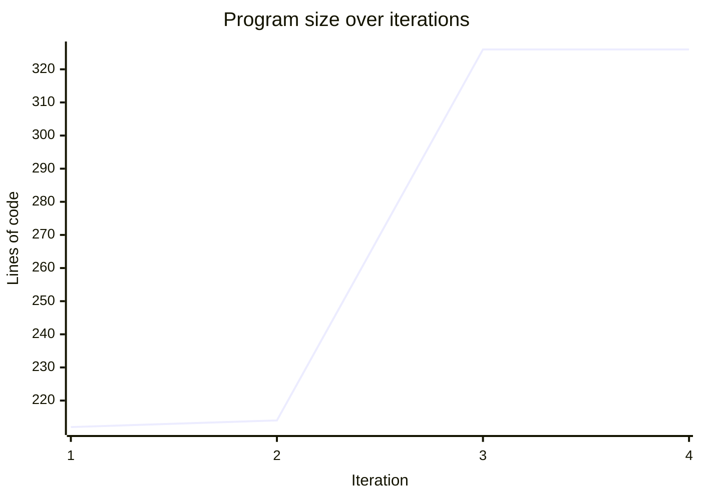

# Run Report: SNOMED

## Parameters

| Parameter | Value |
|-----------|-------|
| Ontology | SNOMED |
| Config | ontology_config.yaml |
| Threshold | 95% |
| Max iterations | 20 |
| Max questions | all |
| Num failures to fix | all |
| Kiro timeout | none |
| Output dir | runs/SNOMED_20260510_191046 |

## Summary

| Metric | Value |
|--------|-------|
| Start time | 2026-05-10 19:10:46 UTC |
| End time | 2026-05-10 19:27:55 UTC |
| Duration | 1029s (17.2 min) |
| Total iterations | 4 |
| Final accuracy | 100.00% |
| Best iteration | 4 |
| Termination reason | threshold_met |
| Judge tokens (input) | 11,596 |
| Judge tokens (output) | 4,032 |
| Judge tokens (total) | 15,628 |
| Judge LLM cost | $0.1588 |
| kiro-cli total duration | 962s (16.0 min) |
| kiro-cli total credits | 10.84 |
| kiro-cli cost | $0.4336 |
| **Total cost** | **$0.5924** |

## Iterations

| Iteration | Accuracy | Correct | Eval (s) | Kiro (s) | Total (s) | LOC | Patch | Evaluation | Judge Tokens | Judge Cost ($) | Kiro Credits | Kiro Cost ($) |
|-----------|----------|---------|----------|----------|-----------|-----|-------|------------|--------------|----------------|--------------|---------------|
| 1 | 0% | 0/4 | 0 | 600 | 601 | [212](iteration_1/query_program.py) | — | [eval](iteration_1/evaluation.json) | 0 | 0.0000 | 6.58 | 0.2632 |
| 2 | 0% | 0/4 | 14 | 84 | 98 | [214](iteration_2/query_program.py) | [patch](iteration_2/changes.patch) | [eval](iteration_2/evaluation.json) | 2,394 | 0.0261 | 0.63 | 0.0252 |
| 3 | 50% | 2/4 | 18 | 278 | 297 | [326](iteration_3/query_program.py) | [patch](iteration_3/changes.patch) | [eval](iteration_3/evaluation.json) | 4,929 | 0.0585 | 3.63 | 0.1452 |
| 4 | 100% | 4/4 | 34 | 0 | 34 | [326](iteration_4/query_program.py) | [patch](iteration_4/changes.patch) | [eval](iteration_4/evaluation.json) | 8,305 | 0.0742 | 0.00 | 0.0000 |
| **Total** | | | **67** | **962** | **1029** | | | | **15,628** | **0.1588** | **10.84** | **0.4336** |

## Progress

```mermaid
xychart-beta
    title "Accuracy over iterations"
    x-axis "Iteration" [1, 2, 3, 4]
    y-axis "Accuracy (%)" 0 --> 100
    line "Accuracy" [0, 0, 50, 100]
```


