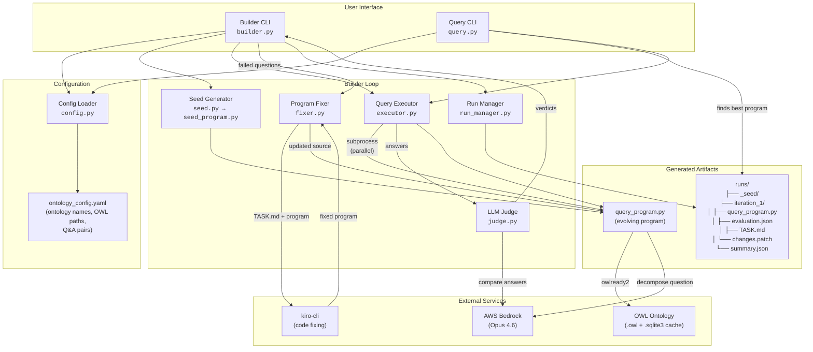

# Functional Architecture Diagram

## Data Flow Summary

### Builder CLI (`python -m ontology_qa_cli.builder <ontology>`)

1. **Load config** → reads `ontology_config.yaml` for ontology metadata and Q&A pairs
2. **Generate seed** → copies `seed_program.py` as the initial `query_program.py`
3. **Evaluation loop** (parallel per question):
   - **Execute** → runs `query_program.py` as subprocess with ontology file + question
   - **Judge** → sends (generated answer, expected answer) to Opus 4.6 for verdict
4. **Fix** → generates `TASK.md` with failures, invokes `kiro-cli` to modify the program
5. **Persist** → saves program, evaluation, patch, and kiro output per iteration
6. **Repeat** until accuracy threshold met or max iterations reached

### Query CLI (`python -m ontology_qa_cli.query <source> <question>`)

1. **Resolve source** → either ontology name (finds best program from latest run) or explicit path
2. **Execute** → runs the resolved `query_program.py` with the question
3. **Output** → prints the answer to stdout

### Key Design Decisions

| Decision | Rationale |
|----------|-----------|
| Subprocess isolation | Buggy query programs can't crash the CLI |
| LLM for question understanding only | Answers come from owlready2 graph traversal, not hallucination |
| SQLite caching | Avoids re-parsing large OWL files on every invocation |
| Parallel evaluation | Questions run concurrently; output printed sequentially |
| kiro-cli via PTY | Streams output in real-time with line buffering |
| Patch files per iteration | Easy to see exactly what changed |
